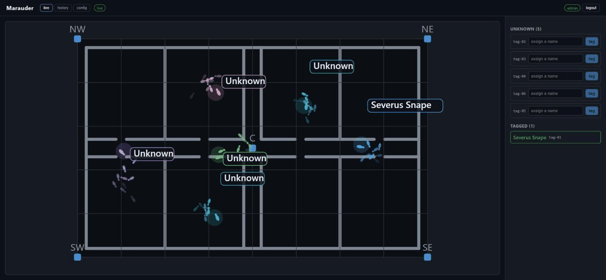

# Marauder

[](https://github.com/mirzanajafov/marauder/actions/workflows/ci.yml)

**Live demo:** [marauder.najafov.dev](https://marauder.najafov.dev). Anyone can watch the map, but naming people needs the admin password.

Real-time indoor positioning for opt-in tags. I built it to see how far you can
push RSSI-based tracking with a clean streaming pipeline: fixed BLE/Wi-Fi tags
report to fixed receivers, and the backend turns that noisy stream into live dots
moving on a floor plan.

The use case is a workplace: staff and assets moving around a building in real time,
each shown by name on the floor plan. The tracked things carry a tag on purpose
(think a staff badge or an asset tag), not phones tracked without consent.



## How it works

A receiver sees a tag and publishes `{ fingerprint, receiverId, rssi, txPower }` over
MQTT, and the API stamps each reading with the time it arrives. The API resolves the
fingerprint to an entity (creating an "unknown" one the first time), estimates a
position from the RSSI readings across receivers, and streams batched position updates
to the web UI over WebSocket. When a new tag appears you tag it with a name once, and
after that it is recognized instantly from a Redis lookup.

Positions come from a log-distance path-loss model. Each receiver's RSSI is smoothed in
dB, the position is fitted to those readings in log-distance space when three or more
receivers hear a tag, and a light moving average keeps markers from jumping. History goes
into a TimescaleDB hypertable so you can replay a session.

## How accurate it is

For a long time I judged this by watching the map, which says nothing. The simulator
knows where every tag really is, so the error in metres is cheap to measure.
`pnpm --filter @marauder/api bench:accuracy` replays the simulator's world with a fixed
seed on a virtual clock (6 tags walking between rooms for 30 minutes), feeds the API's own
tracker, and compares every 150 ms update with where the tag actually was. Every variant
sees the identical signal stream, and the numbers land in `apps/api/bench/accuracy.json`.

The first run was humbling. I had been using linearised trilateration plus a moving
average, and from 3 dB of noise up the raw trilateration was worse than a plain weighted
centroid. At 6 dB a quarter of its answers landed outside the building. With the
building's path-loss exponent at 3.0 while the solver assumed 2.5, the live output sat
outside the building a third of the time, and smoothing couldn't help, because that's bias,
not noise.

So I changed three things, and kept each one only because the benchmark agreed:

- **Fit in log-distance space.** RSSI noise is Gaussian in dB, and dB is the log of
  distance, so that's where the fit minimises its error. The old solver linearised the
  circles around one reference receiver, which amplified that receiver's noise. The
  answer is also clamped to the floor plan now.
- **Smooth each receiver's RSSI before solving** (EMA 0.2), not only the answer. Averaging
  in dB averages the noise where it is linear, but averaging positions after a nonlinear
  solver doesn't. The position average went from 0.18 to 0.3 because its input is calmer.
- **Let the fit stretch the distances.** With four or more receivers it also fits one
  scale on the log-distances, which is what a wrong path-loss exponent does to them.

The second change on its own made the wrong-exponent case worse, 3.03 m median to 5.20 m:
with the noise averaged away, the fit settled confidently on the biased answer. The third
change is what fixed it.

Median / p95 error in metres:

|                                                    | before       | after        |
| -------------------------------------------------- | ------------ | ------------ |
| 1.2 dB noise (simulator default)                   | 1.01 / 1.95  | 1.03 / 1.62  |
| 3 dB                                               | 1.88 / 4.06  | 1.30 / 2.74  |
| 6 dB                                               | 3.59 / 7.90  | 2.04 / 4.98  |
| 3 dB, building at exponent 3.0, solver assumes 2.5 | 3.56 / 20.11 | 1.20 / 2.40  |
| 3 dB, each receiver off by a fixed offset          | 8.71 / 20.02 | 4.33 / 10.28 |

The wrong-exponent row is exactly the error the scale term models, so I added the last row
as a check I didn't design the fix around: each receiver reads a fixed number of dB high or
low, like a different antenna. The new estimator is better there too, and nothing lands
outside the building any more (20% did before), but the scale term barely matters (4.53 m
without it, 4.33 with) and it's still 3 m worse than the clean case. Per-receiver
calibration would fix that, and it only makes sense with real hardware. At the simulator's
default noise the median didn't move, but the gain there is in the tail. A walking tag is
now about 1.1 m off and a standing one about 0.4 m.

These numbers are a floor, not a promise. The simulator draws RSSI from the same
log-distance model the solver inverts, with Gaussian noise, no multipath and no walls in
the radio path, and the offset row is one draw of five offsets, not an average over many.

## Stack

- NestJS + TypeScript API
- MQTT (Mosquitto) for signal ingest
- Redis as a short-lived entity cache keyed by fingerprint
- JWT auth guarding the write endpoints
- TimescaleDB for position history
- React + Vite map UI
- A simulator that generates noisy receiver traffic, so you can run the whole thing
  without hardware

It runs as one API instance, and I want to be clear about why. Every instance subscribes to
every receiver's topic and keeps its own tracks in memory, so two instances would both
solve every tag and broadcast it twice. For a while I had the Socket.IO Redis adapter wired
so sockets on several instances would share broadcasts, but that alone never made it scale
out, so I took it out along with the two Redis connections it kept open. Scaling out needs
one owner per tag, either a lease per group of tags in Redis or a broker that partitions by
fingerprint, and the adapter would come back with that. The demo doesn't need it yet. One
instance takes the simulator's ~280 signals a second at somewhere between 14% and 56% of
one core in a quick sample on the server, and every signal still costs a Redis read to
resolve its fingerprint (it was two until the entity cache moved to one key per
fingerprint), which is the first thing I'd cache in process if the load grew.

## Run it

```
cp apps/api/.env.example apps/api/.env
cp apps/simulator/.env.example apps/simulator/.env
docker compose up -d
pnpm install
pnpm --filter api prisma migrate deploy
pnpm dev
```

Then open the web app, watch tags appear as "unknown", and name one. Restart the
simulator and it comes back already named. Tagging and the config tab need the admin
password, which is `ADMIN_PASSWORD` in that `.env`. Log in from the top bar. The API checks
its whole config when it starts and won't run with a key missing or malformed (it names
every one that is), so the copied `.env` is not optional. The simulator checks its own
`.env` the same way, and that is where its knobs live (tag count, noise, dropouts, walking
speed).

## Deploying

The live demo runs from `deploy/docker-compose.prod.yml` on a small VPS, behind a
Caddy that several of my projects share. Nothing publishes a port: the web container
joins that proxy's `edge` network. A release is `deploy/deploy.sh`: it backs up,
fast-forwards to `origin/main` and builds the three images from one multi-stage
`deploy/Dockerfile`. Before anything restarts, it runs the new API image against the
server's `.env` and the new simulator image against its own settings, and stops if either
one refuses, so a bad secret can't take the running site down. Then it compares the
migrations the release ships with the ones the database has applied, and stops if the
database has one the release doesn't know or one recorded as failed. A release with
migrations stops the old API and migrates with the new image first, because the old code
can't always read the new schema (the status enum was the first time). Then it restarts,
waits for the containers' health checks (the API's `/api/health` only answers 200 while
Postgres, Redis and the MQTT broker are all reachable) and makes one request to it
through the site's own proxy. If any of that fails, a release without migrations goes
back to the commit and the exact images that were running before, without rebuilding
them. A release with migrations goes back only if no migration started. Once one did, it
may have committed part of its SQL, so the script says so and leaves the way back to me:
fix forward, or restore the predeploy dump.

The API and simulator images share one layer with the production dependencies of the two
of them, without pnpm and with no file the process can write to. The two of them
used to be 1.35 GB and 1.26 GB on the server, built separately. Now they are 453 MB
together, of which each one adds less than 1 MB. My first version of the shared layer was
764 MB, because `pnpm fetch` had already put every development package into
`node_modules` and a production install doesn't take them out again.

The backup container dumps the database every night and keeps two weeks. I leave the
position history out on purpose. It is simulator traffic that refills itself within
minutes, and keeping it made a 3 GB volume out of what is really a few kilobytes of
names, floor plans and receivers. Restoring one into an empty database:

```
docker exec marauder-timescaledb psql -U marauder -c "SELECT timescaledb_pre_restore();"
docker exec -i marauder-timescaledb pg_restore -U marauder -d marauder --no-owner < marauder-<time>.dump
docker exec marauder-timescaledb psql -U marauder -c "SELECT timescaledb_post_restore();"
```

The API reloads the receivers and the floor plan after every edit it makes and once a
minute on its own, and its cached entities expire after a minute, so a restore shows up
within a minute.

The history itself keeps one day, which I learned the hard way. Six simulated tags write
about 40 rows a second, and with no retention that had become a 3.65 GB table in under
four days, on a server my other projects share. The history summary took 28 seconds
because it counted every row, and the history view asked for the whole range at once and
never finished loading. Now the table is cut into hourly chunks and a Timescale job drops
the ones older than 24 hours every hour. The summary only reads the first and last
timestamp (10 ms on the server), and the view loads the last 10 minutes or the last hour.
The API refuses any request that would need more than 2,000 buckets, so nobody can ask
for a week at half-second resolution. Those two windows take 100 and 160 ms.

## Layout

- `apps/api`: NestJS backend
- `apps/simulator`: MQTT traffic generator
- `apps/web`: map + admin UI
- `packages/shared`: wire types, MQTT and WebSocket names, the default building and receivers,
  radio defaults, and the world model that the simulator and the bench run
- `packages/env`: config validation for the API and the simulator

## Real sensors

The map is fed over MQTT, so any receiver that publishes `sensors/<receiverId>/signals`
with `{ fingerprint, receiverId, rssi, txPower }` works. Ids are letters, digits, dots,
colons, dashes and underscores: a fingerprint has at most 64 of them, and a receiver id
starts with a letter or digit and has at most 40, since it ends up in URLs and in the
topic. `rssi` and `txPower` are dBm above -127 and at most 20, since an RSSI of -127 means
no signal (bleak reports it when BlueZ has none). A payload that breaks these rules, or
comes as a retained MQTT message, is dropped and counted in the API log.
`txPower` is the RSSI the receiver expects from a tag at 1 m, not the Tx Power Level a
BLE tag may advertise, which is the power at its antenna (often 0 dBm, which would put
every tag hundreds of metres away). So both reference receivers send their calibrated
`TX_POWER` (-59 by default) and skip readings whose RSSI is a "not available" value. The
simulator is just one source. Two reference receivers live in `hardware/`:

- `hardware/esp32-receiver`: an ESP32 sketch (PlatformIO) that BLE-scans and publishes
  RSSI. Set the wifi, MQTT host, `RECEIVER_ID` and `TX_POWER` at the top, flash three
  boards placed apart, and register them in the config tab.
- `hardware/ble-scanner`: a cross-platform Python scanner for a laptop or Raspberry Pi.
  Install with `pip install -r requirements.txt`, then run
  `MQTT_HOST=... RECEIVER_ID=R1 TX_POWER=-59 python scanner.py`. It refuses to start with
  an id or `TX_POWER` the API would drop.

Use fixed-id BLE beacons (or a phone in beacon mode) as tags. Each shows up as unknown
until you name it. Set each receiver's position in the config tab and tune
`PATH_LOSS_EXPONENT` and each receiver's `TX_POWER` for your space.
